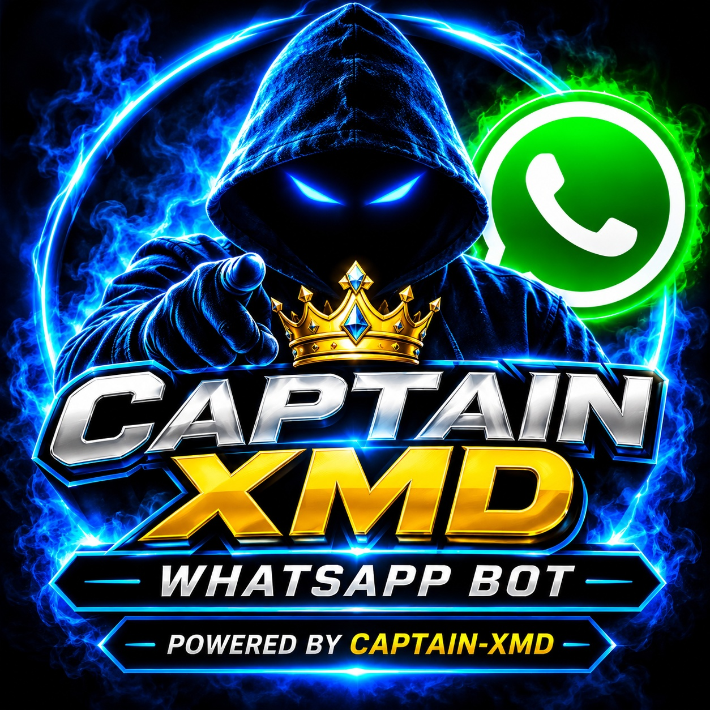

<div align="center">


<br/>



<br/>

<h1>☠️ CAPTAIN-XMD</h1>

<h3>⚡ WHATSAPP AUTOMATION • CYBER LAB • COMMAND CENTER ⚡</h3>

<p>
  
  
  
</p>

<p>
  <a href="https://captain-bot-xmd-8.onrender.com/">
    
  </a>
  <a href="https://github.com/Aloice-f/captain-xmd">
    
  </a>
</p>

</div>

---

<div align="center">

## `root@captain-lab:~$ ./initialize`

</div>

```text
╔══════════════════════════════════════════════════════════╗
║               CAPTAIN-XMD // CYBER LAB                 ║
╠══════════════════════════════════════════════════════════╣
║                                                        ║
║  [✓] INITIALIZING CAPTAIN CORE                         ║
║  [✓] LOADING WHATSAPP ENGINE                           ║
║  [✓] LOADING AUTOMATION MODULES                        ║
║  [✓] COMMAND SYSTEM READY                              ║
║  [✓] SECURITY CHECK COMPLETE                            ║
║  [✓] CONNECTION STATUS: ONLINE                         ║
║                                                        ║
║  > SYSTEM: CAPTAIN-XMD                                 ║
║  > OPERATOR: CAPTAIN                                   ║
║  > LAB STATUS: ACTIVE                                   ║
║  > ACCESS: GRANTED                                      ║
║                                                        ║
╚══════════════════════════════════════════════════════════╝
```

<div align="center">

### `⚡ WELCOME TO THE CAPTAIN LAB ⚡`

**Where automation meets the command line.**

</div>

---

## 🧬 About The Project

**CAPTAIN-XMD** is a WhatsApp automation bot project designed to bring automation, commands, and bot tools together in one system.

Welcome to the **Captain Lab** — a cyber-themed command environment built for automation, experimentation, and development.

---

## 🚀 ACCESS THE CAPTAIN LAB

<div align="center">

### 🖥️ LIVE COMMAND CENTER

[](https://captain-bot-xmd-8.onrender.com/)

**🌐 Website:**

</div>

---

## ⚙️ FEATURES

```diff
+ WhatsApp Bot Automation
+ Command-Based System
+ Interactive Bot Tools
+ Cyber-Themed Captain Lab
+ Custom Bot Branding
+ Modular Bot Development
+ Terminal-Inspired Interface
+ Ongoing Updates & Improvements
```

---

## 🛠️ TECHNOLOGY

<div align="center">


</div>

---

## 📥 INSTALLATION

### `STEP 01` — Clone the repository

```bash
git clone https://github.com/Aloice-f/captain-xmd.git
```

### `STEP 02` — Enter the project directory

```bash
cd captain-xmd
```

### `STEP 03` — Install dependencies

```bash
npm install
```

### `STEP 04` — Configure the bot

Configure your environment variables according to the project's configuration files.

### `STEP 05` — Start the bot

Use the start command configured in your `package.json`.

---

## 💻 TERMINAL

```bash
┌──(captain㉿lab)-[~/captain-xmd]
└─$ npm install

┌──(captain㉿lab)-[~/captain-xmd]
└─$ npm start

[ CAPTAIN ] Initializing system...
[ CAPTAIN ] Loading modules...
[ CAPTAIN ] Preparing command center...
[ CAPTAIN ] SYSTEM READY 🚀
```

---

## 🌐 CONNECT WITH CAPTAIN

<div align="center">

| PLATFORM | LINK |
|:---:|:---|
| 🧪 Captain Lab | [Launch Website](https://captain-bot-xmd-8.onrender.com/) |
| 💻 GitHub Repository | [Captain-XMD Source](https://github.com/Aloice-f/captain-xmd) |
| ⚡ Project | **CAPTAIN-XMD** |

</div>

---

## 🖥️ CAPTAIN LAB

```text
      _______             _____  _______ _____ _   _ 
     |__   __|           |  __ \|  ___|_   _| \ | |
        | | __ _ _ __    | |__) | |__   | | |  \| |
        | |/ _` | '_ \   |  ___/|  __|  | | | . ` |
        | | (_| | |_) |  | |    | |___ _| |_| |\  |
        |_|\__,_| .__/   |_|    |_____|_____|_| \_|
              | |
              |_|

           [ CAPTAIN CYBER LAB ]
           [ SYSTEM STATUS: ONLINE ]
           [ OPERATOR: CAPTAIN ]
           [ ACCESS: GRANTED ]
```

---

## ⚠️ DISCLAIMER

This project is intended for educational, development, and authorized automation purposes.

Use responsibly. You are responsible for your account, deployment, and how you use this software.

---

<div align="center">

## `SYSTEM MESSAGE`

```text
THE SYSTEM NEVER SLEEPS.
THE CAPTAIN NEVER STOPS.
WELCOME TO THE LAB.
```

### ⚡ POWERED BY CAPTAIN ⚡


**© CAPTAIN-XMD | ALL SYSTEMS OPERATIONAL**

</div>
